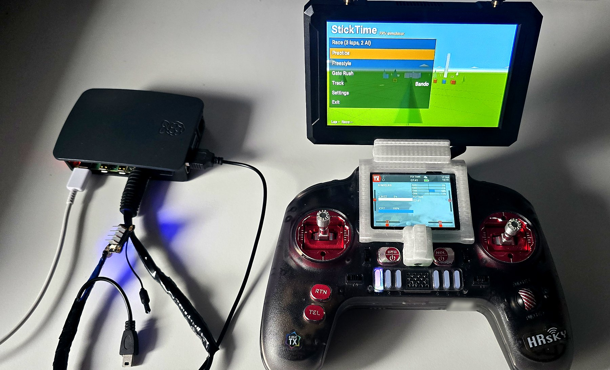
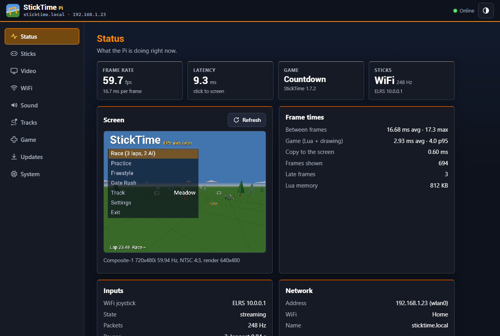
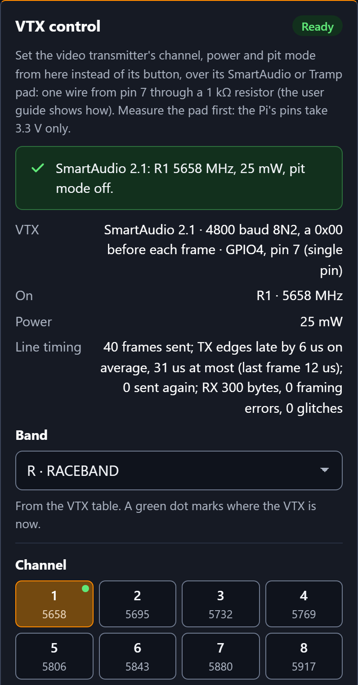

# StickTime Pi

Turn a Raspberry Pi into a "virtual quad". StickTime Pi runs the [StickTime](https://github.com/juricabi/sticktime)
FPV simulator and sends the picture to your **analog FPV goggles** through a 5.8 GHz VTX wired to the
Pi's AV jack, or over HDMI to goggles with an HDMI input or to any screen. You fly it with your own radio.



*A real setup: the Raspberry Pi (left) sends the picture through a 5.8 GHz VTX to an analog FPV monitor, and an EdgeTX radio flies it.*

> **Safety:** your radio keeps transmitting while you fly the sim. Take the props off the real quad or
> unplug its battery.





## Features

- **Video for goggles**: composite NTSC or PAL (4:3 or 16:9, adjustable margin) straight into a VTX for
  analog goggles, or HDMI for goggles with an HDMI input (and any HDMI screen).
- **Your radio as the controller**: ExpressLRS and TBS Crossfire **WiFi joystick** (the same protocol as
  [ELRS-Crossfire-WiFi-Joystick-Windows](https://github.com/juricabi/ELRS-Crossfire-WiFi-Joystick-Windows)),
  an EdgeTX/OpenTX radio as a **USB joystick**, the ELRS **BLE joystick**, gamepads and keyboards.
  Menus work with the sticks, so the goggles can stay on.
- **Low latency**: native code, frames go straight to the display with page flips, and the sticks are
  read just before each frame. The web page shows the measured frame and stick latency.
- **Sound** on the jack (to the VTX's audio pad) or HDMI: motor sound, beeps, generated music, and your
  own songs (MP3, OGG, FLAC, WAV).
- **VTX control**: set the VTX's band, channel or frequency, power and pit mode from the web page or
  `sticktime.txt` over its **SmartAudio** (1.0, 2.0, 2.1) or **Tramp** pad, with Betaflight-style VTX tables
  (load your VTX maker's file). One wire and a resistor to a GPIO pin, like a flight controller; the Pi finds
  the protocol by itself.
- **All three StickTime editions**: color, B&W and Lite, as on a radio; pick one on the web page's Game tab.
- **Tracks like the browser emulator**: custom tracks c1-c8, the track editor, the track gallery, and the
  emulator's **Install** button to put the game on the Pi.
- **Web page** at `http://sticktime.local`: WiFi (scan, join, hotspot), sticks (live bars, channel order,
  stick mapping with a Detect wizard, invert, pause switch), video, sound, tracks, a remote keypad, updates,
  system and log.
- **Updates** of the game (all three editions together) and of StickTime Pi itself from GitHub releases,
  with rollback. Saves, tracks and ghosts are never touched.
- **Everything on the SD card's FAT partition** (`sticktime.txt`, tracks, saves, songs), so you can edit
  it from a PC.

## Quick start

1. **Flash** `sticktime-pi-<version>.img.xz` from the [releases](https://github.com/juricabi/sticktime-pi/releases)
   with Raspberry Pi Imager ("Use custom") or balenaEtcher. Skip Imager's "OS customisation".
2. **Settings (optional)**: open `sticktime.txt` on the card's `bootfs` drive. Every setting is explained
   there: `video = av` or `hdmi`, `tv = ntsc` or `pal`, `aspect`, your WiFi. Without WiFi settings the Pi
   opens its own network **StickTime** (password `sticktime`).
3. **Wire the VTX** (below), insert the card and power the Pi. The first boot restarts once by itself,
   then the StickTime menu appears in your goggles, with the web address at the bottom.

The full guide: **[docs/USER_GUIDE.md](docs/USER_GUIDE.md)** (wiring, radios, the web page, sound,
updates, troubleshooting).

## What you need

- A Raspberry Pi (any RAM size; see the models below), a 5 V / 3 A power supply, a microSD card of 8 GB or more.
- For analog goggles: a 5.8 GHz VTX with its own power, and a 3.5 mm TRRS plug or cable. For goggles
  with an HDMI input, or a screen: a micro-HDMI cable (set `video = hdmi`).
- Your radio (see Features), or a gamepad.

**Raspberry Pi models:** StickTime Pi runs on Raspberry Pis that run 64-bit Raspberry Pi OS (so not on a
Pi 1, Zero, Zero W or early Pi 2). It is developed and tested on a Pi 4, which has the AV jack for the VTX.
On other models: the Pi 3 / 3B+ has the same AV jack, with about half the CPU speed; the Zero 2 W is slower
still and has composite only on solder pads and no audio jack; the Pi 5 has composite only on solder pads
and no audio jack; the Pi 400 has no composite output (HDMI only). Reports from other models are welcome.

## Wiring the VTX

The Pi's 3.5 mm jack is TRRS:

| Contact | Signal | Connect to |
|---|---|---|
| tip | left audio | VTX audio pad (optional) |
| ring 1 | right audio | (or here, with `audio_mono = on`) |
| ring 2 | ground | VTX ground |
| sleeve | **composite video** | VTX video in |

Attach the VTX antenna before powering it, and set it to 25 mW.

Optional **VTX control**: one wire from Pi pin 7 (GPIO4) through a 1 kΩ resistor to the VTX's SmartAudio/Tramp
pad, then `vtx = auto` (for the most reliable link add pin 29 through 4.7 kΩ and set `vtx_port = uart3`; see the
[user guide](docs/USER_GUIDE.md#9-vtx-control-smartaudio--tramp)).
**The Pi's pins take 3.3 V only: measure the pad first, and use a level shifter if it shows more than 3.3 V.**

## Status

StickTime Pi runs on real Raspberry Pis. Please [open an issue](https://github.com/juricabi/sticktime-pi/issues)
with your setup (goggles, VTX, radio, TV standard) when something doesn't work, and also when it does.

## How it works

The game itself runs **unchanged** (`StickTime.lua`, and the B&W editions' loaders and `core.lua`, which they
run on a color screen): StickTime Pi is a native C host that implements the
EdgeTX Lua API, a port of the color radio drawing in StickTime's browser emulator (`engine.js`), with
Lua 5.3 using EdgeTX's number settings. It draws into RGB565 buffers and shows them with DRM/KMS page flips
(no X, Wayland or browser), reads the sticks from evdev and UDP, and mixes the sound itself. It is one
static aarch64 program, so an update is one file and it runs on any Pi OS version.

The SD image is Raspberry Pi OS Lite (64-bit) with StickTime Pi added; the image build edits the official
image from the outside, without running anything inside it.

More: [docs/PLAN.md](docs/PLAN.md) (design), [docs/RESEARCH.md](docs/RESEARCH.md) (verified facts and
sources), [docs/WEB_API.md](docs/WEB_API.md) (the web API).

## Building from source

```sh
host/build.sh native test     # the program and its unit tests on this machine (zig cc or cc)
host/build.sh aarch64         # the static Pi program: build/aarch64-edgetx/sticktime-pi
sudo BIN=build/aarch64-edgetx/sticktime-pi VER=0.1.0 image/build.sh     # the SD image (Linux, root)
```

Keep the [StickTime](https://github.com/juricabi/sticktime) repo checked out next to this one (`../sticktime`):
the tests compare against its emulator. Toolchains, every test suite, the image build and the QEMU boot
test: **[docs/DEVELOPMENT.md](docs/DEVELOPMENT.md)**.

## Contributing

Bug reports, hardware reports and pull requests are welcome. See [CONTRIBUTING.md](CONTRIBUTING.md).
Security problems: [SECURITY.md](SECURITY.md).

## Support

StickTime Pi is free and made in my spare time. If you like it, you can buy me a coffee:

[](https://ko-fi.com/juricabi)

## License

StickTime Pi is free software under the [GNU General Public License v2.0](LICENSE), like StickTime.

Bundled third-party code keeps its own license: Lua 5.3.6 (MIT); stb_truetype, stb_image_write and
stb_vorbis (MIT or public domain); minimp3 (CC0); dr_wav and dr_flac (Unlicense or MIT-0); the Roboto
fonts (SIL Open Font License, `host/fonts/OFL.txt`). Versions and sources: `host/third_party/README.md`.
The SD image also contains Raspberry Pi OS and its packages, under their own licenses.

StickTime and the WiFi joystick protocol code it is ported from are by the same author.
