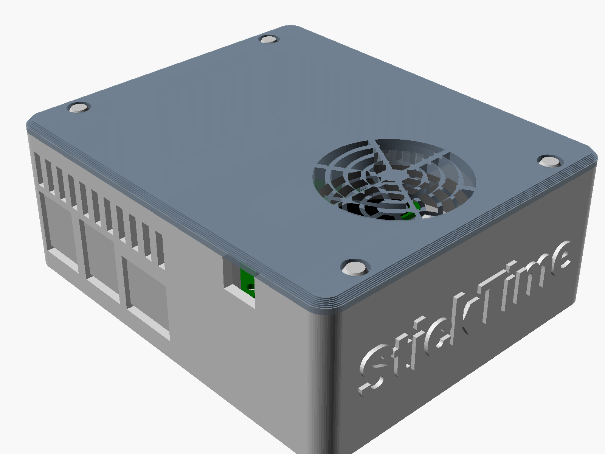
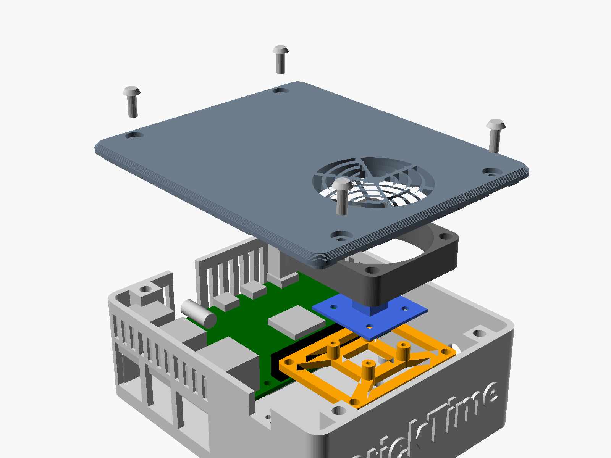
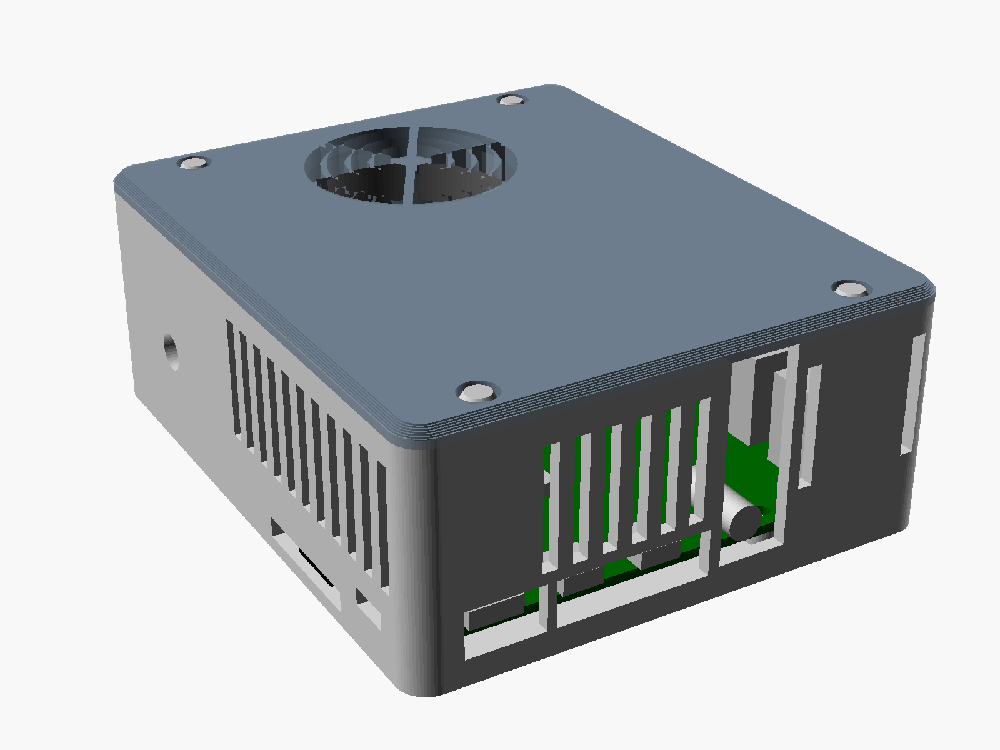
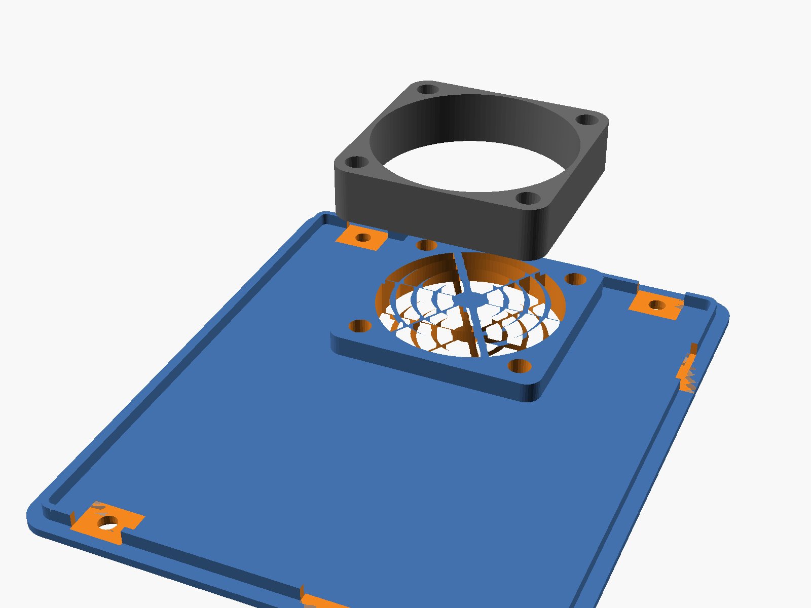
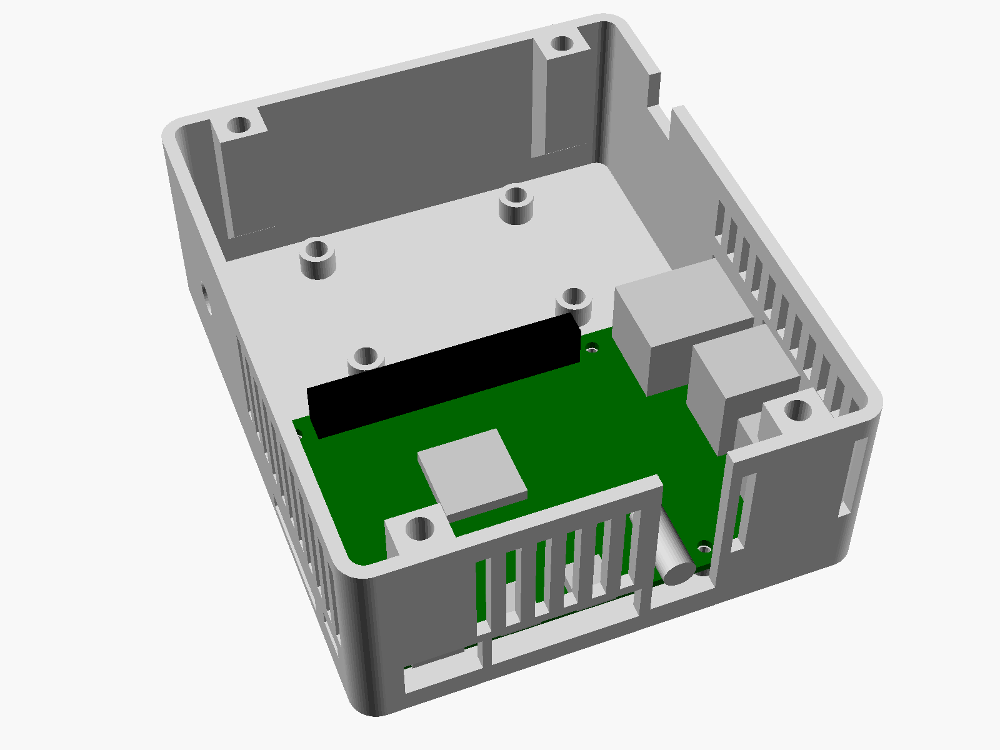
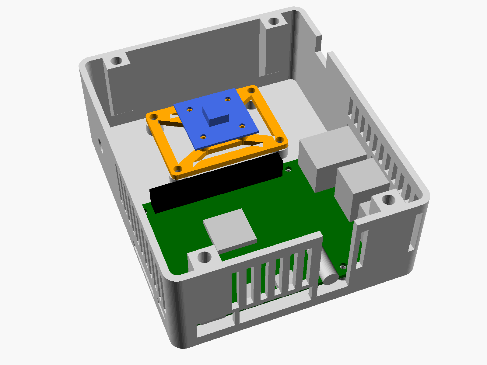
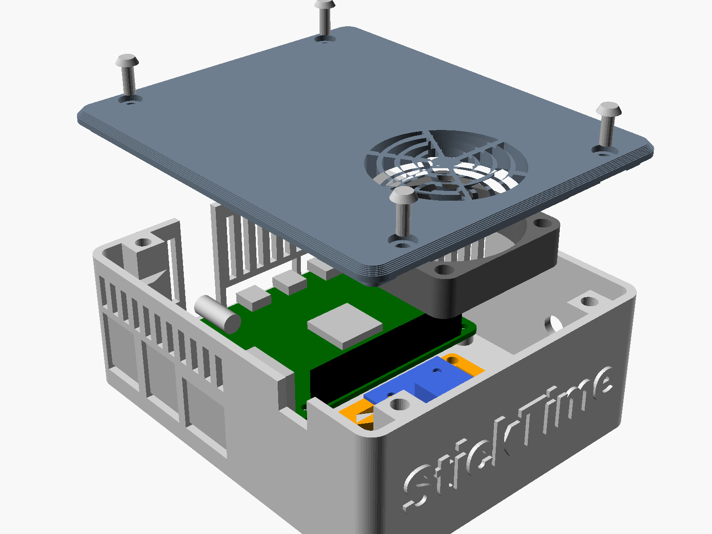

# StickTime Pi case

A 3D-printed box for the whole setup: the Raspberry Pi 4, the 5.8 GHz VTX and a 40 mm fan. The VTX is
the hot part, so it gets the fan head-on; the Pi gets the same air on its way out. The VTX's power, its
SmartAudio wire and the fan's wires stay inside, next to the GPIO header; only the AV plug and the
antenna come out.





## How it cools

The fan hangs under the lid's grill, over the VTX bay along the Pi's GPIO edge, and blows down on the
VTX. The VTX sits on an open frame: two thin rings and four spokes, with the standoffs on the inner
ring, so there is nothing under the board but air and both of its sides are in the stream. The bay's
walls are closed, so the air then has to cross the Pi to get out: over the GPIO header, over the SoC,
and out through the slots in the Pi's three walls above the ports. The VTX's watt or two warms that air
by about a degree, so the Pi still gets room-temperature air moving over it.



## Parts

| Part | Count | Notes |
|---|---|---|
| `stl/base.stl` | 1 | print as is |
| `stl/lid.stl` | 1 | print as is (the STL is already upside down) |
| `stl/frame_16.stl`, `frame_20.stl`, `frame_25.stl` or `frame_30.stl` | 1 | the frame for your VTX's hole spacing (16x16, 20x20, 25.5x25.5, 30.5x30.5) |
| 40x40x10 mm fan, 5 V, 2 wires | 1 | to GPIO pins 4 (5 V) and 6 (GND) |
| Heat-set inserts M3 x D5 x L4 ("Voron" inserts) | 12 | 4 lid, 4 fan, 4 frame; hole 4.4 mm (`insert_d`) |
| M3 x 8, button head or countersunk | 4 | lid; the heads sit flush in the lid |
| M3 x 14 | 4 | fan to the lid |
| M3 x 6 | 4 | frame to its posts |
| M2.5 x 6 | 4 | Pi (they cut their own thread in the standoffs) |
| M2 x 6 (M3 x 6 on the 30.5 frame), or two small zip ties | 4 | VTX to the frame, see below |
| SMA bulkhead pigtail | 1 | optional: 6.5 mm hole in the bay's SD-card end wall, level with the VTX |

PETG or PLA, 0.2 mm layers, 3 walls, no supports: nothing overhangs more than 45 degrees (the lid
bosses' undersides, the lid's chamfer). Outside: 92 x 110 x 42 mm.

## Assembly

1. **Inserts.** Press the 12 inserts in with a soldering iron: 4 in the lid's fan pad (from the
   inside), 4 in the base's frame posts, 4 in the tops of the bosses on the base's long walls.
2. **Fan into the lid.** Lid upside down on the bench, fan onto the pad with its label (the side the
   air comes out of) *away* from the lid, 4x M3 x 14.

   
3. **Pi into the base**, onto its four standoffs, 4x M2.5 x 6. The SD card goes in and out through the
   slot in the end wall.

   
4. **VTX onto the frame** (screws into the standoffs, or zip ties round the bars), **frame onto its
   posts**, 4x M3 x 6. Antenna: an SMA bulkhead in the hole in the bay's end wall, or a whip out through
   the notch at the top of the other end wall.

   
5. **Wires.** The AV cable's plug goes into the jack from outside and the cable comes back in through
   the same opening (it runs up to the rim). From the header to the VTX: the SmartAudio wire (pin 7
   through 1 kΩ), and 5 V (pin 2) with ground (pin 9) if the VTX takes 5 V from the Pi. The fan goes on
   pins 4 and 6.
6. **Lid on**, 4x M3 x 8 into the bosses. The lip inside the rim locates it.

   

The lid has an optional slot over the GPIO header for wires to the outside (`gpio_slot = true`).

## VTX mounting

The frame has four standoffs at the VTX's hole spacing, 5 mm tall, on a ring that leaves the middle of
the board open. On the 16, 20 and 25.5 frames the standoffs are thin (4.4 mm, so the parts next to a
small board's holes stay clear) with 1.8 mm holes for M2 screws, which cut their own thread; the 30.5
frame has 6 mm standoffs with 2.7 mm holes for M3. A VTX with odd holes, or none, is strapped to the
frame's bars with two zip ties. There are 10 mm between the board and the fan for a heatsink, and
10 mm of air under the board.

Everything about the frame is a parameter in `sticktime_case.scad`:

| Parameter | What it is | Default |
|---|---|---|
| `vtx_pattern` | hole spacing | 16 |
| `vtx_hole_d` | hole in the standoffs: 1.8 (M2 self-tapping), 2.2 (M2.5), 2.7 (M3), or a clearance size with a nut | 1.8 |
| `vtx_nut_af` | nut trap in the top of each standoff, across flats (M2 4.0, M2.5 5.0, M3 5.5); 0 = none | 0 |
| `vtx_standoff_h` | the board's height above the frame | 5 |
| `vtx_standoff_d` | the standoffs' diameter (M2.5 wants 5, M3 wants 6) | 4.4 |

To render a frame for your VTX (OpenSCAD 2021.01 or newer; the name uses `host/fonts/Roboto-Bold.ttf`
from this repo, so render from a checkout):

```sh
openscad -D 'part="frame"' -D vtx_pattern=20 -o frame.stl sticktime_case.scad
```

The other parameters (`inner_h`, `bay_w`, `insert_d`, the logo, the openings) are at the top of the file
with a comment each. `part="assembly"` shows everything in place with a Pi, a fan and a VTX drawn in;
`exploded` pulls it apart.
