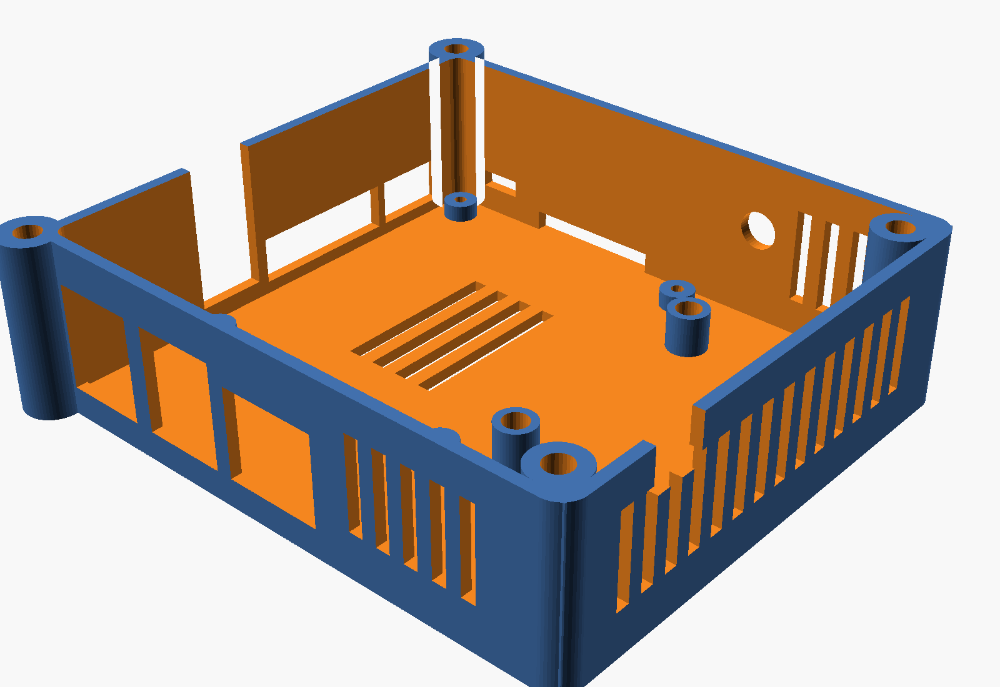

# StickTime Pi case

A 3D-printed box for the whole setup: the Raspberry Pi 4, the 5.8 GHz VTX and a 40 mm fan that cools
both. The VTX sits on its own tray next to the Pi's GPIO header, so its power, its SmartAudio wire and
the fan's wires stay inside; only the AV plug and the antenna come out.




## How it cools

The fan is on the lid, over the Pi's SoC and RAM, and blows down. The only way out is the VTX bay along
the GPIO edge: the air passes over the Pi, over and under the VTX on its tray, and leaves through the
slots in the bay's three outer walls. Slots in the floor under the SoC let air in from below too.

## Parts

| Part | Count | Notes |
|---|---|---|
| `stl/base.stl` | 1 | print as is |
| `stl/lid.stl` | 1 | print as is (the STL is already upside down) |
| `stl/tray_16.stl`, `tray_20.stl`, `tray_25.stl` or `tray_30.stl` | 1 | the tray for your VTX's hole spacing (16x16, 20x20, 25.5x25.5, 30.5x30.5) |
| `stl/guard.stl` | 1 | finger guard on top of the fan, optional |
| 40x40x10 mm fan, 5 V, 2 wires | 1 | to GPIO pins 4 (5 V) and 6 (GND) |
| Heat-set inserts M3 x D5 x L4 ("Voron" inserts) | 12 | 4 lid, 4 fan, 4 tray; hole 4.4 mm (`insert_d`) |
| M3 x 8 countersunk | 4 | lid |
| M3 x 16 (M3 x 14 without the guard) | 4 | fan |
| M3 x 6 | 4 | tray |
| M2.5 x 6 | 4 | Pi (they cut their own thread in the standoffs) |
| M2.5 x 6 or M2 x 6, or two small zip ties | 4 | VTX to the tray, see below |
| SMA bulkhead pigtail | 1 | optional: 6.5 mm hole in the bay's SD-card end wall |

PETG or PLA, 0.2 mm layers, 3 walls, no supports. Outside: 102.5 x 106.5 x 32.5 mm, plus the fan on top.

## VTX mounting

The tray has four standoffs at the VTX's hole spacing. The holes are 2.2 mm on the 16, 20 and 25.5
trays (M2.5 screws cut their own thread; M2 screws fit loosely, use the nut trap or zip ties), and
2.7 mm on the 30.5 tray (M3). Next to the standoffs are eight zip-tie slots, two on each side of the
board, so a VTX with odd holes, or no holes, is strapped down instead. Set `vtx_standoff_h = 0` for a
tray without standoffs if the VTX lies flat under its zip ties.

Everything about the tray is a parameter in `sticktime_case.scad`:

| Parameter | What it is | Default |
|---|---|---|
| `vtx_pattern` | hole spacing | 16 |
| `vtx_hole_d` | hole in the standoffs: 2.2 (M2.5 self-tapping), 1.7 (M2), 2.7 (M3), or a clearance size with a nut | 2.2 |
| `vtx_nut_af` | nut trap in the top of each standoff, across flats (M2 4.0, M2.5 5.0, M3 5.5); 0 = none | 0 |
| `vtx_standoff_h` | the board's height above the tray; 0 = no standoffs | 4 |
| `vtx_board` | the board's outline, the zip-tie slots sit just outside it | [26, 26] |
| `tie_slots` | the zip-tie slots | true |

To render a tray for your VTX (OpenSCAD 2021.01 or newer):

```sh
openscad -D 'part="tray"' -D vtx_pattern=20 -D 'vtx_board=[28,28]' -o tray.stl sticktime_case.scad
```

The other parameters (`inner_h`, `bay_w`, `fan_c`, `insert_d`, the openings) are at the top of the file
with a comment each. `part="assembly"` shows everything in place with a Pi, a fan and a VTX drawn in.

## Assembly

1. Press the 12 inserts in with a soldering iron: 2 in the ears at the HDMI-side corners of the base and
   2 in the posts at the bay's corners, 4 in the tray posts, 4 in the lid around the fan opening (from
   the top).
2. Pi on its four standoffs, 4x M2.5 x 6. The SD card goes in and out through the slot in the end wall.
3. VTX on the tray (screws or zip ties), tray on its posts with 4x M3 x 6. Antenna: an SMA bulkhead in
   the end wall of the bay, or a whip out through the notch at the top of the bay's outer wall.
4. Wires: the AV cable's plug goes into the jack from outside and the cable comes back in through the
   same opening (it runs up to the rim). The SmartAudio wire (pin 7 through 1 kΩ) and the VTX's 5 V, if
   it takes it from the Pi, go straight from the header to the bay. The fan's wires go down through the
   small slot next to the fan's corner to pins 4 and 6.
5. Fan on the lid (the label, which is the exhaust side, faces down into the case), guard on the fan,
   4x M3 x 16. Lid on, 4x M3 x 8.

The lid has an optional slot over the GPIO header for wires to the outside (`gpio_slot = true`).
